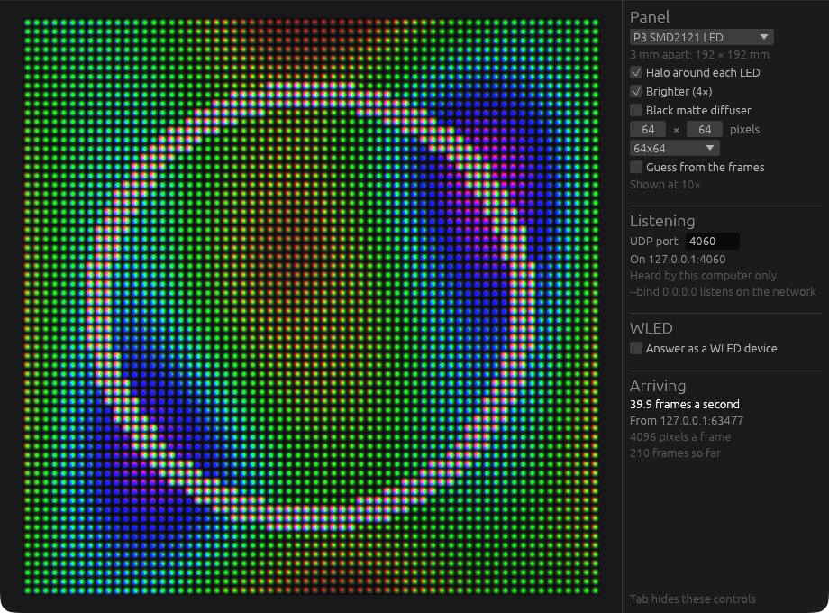

# ddpview

A virtual LED panel for the desktop. `ddpview` listens for DDP, the pixel
protocol that [WLED](https://kno.wled.ge) devices accept over UDP, and
shows the frames it receives in a window: what a program would put on an
LED matrix, before the matrix is on the desk.



- Receives DDP on UDP port 4048, frames of any number of packets.
- Shows the panel as plain square pixels, or as an LED matrix (P3 with
  SMD2121 LEDs, or P1.875 with SMD1515), as large as fits the window.
- The panel's size is typed in, picked from presets, or guessed from the
  number of pixels in a frame.
- Shows the frame rate arriving and who is sending, and says so when
  nothing is.
- Remembers the size, the panel type and the port between runs.
- Listens on this computer only, unless asked to listen on the network.
- Can pass every packet on to other DDP receivers, such as a real panel.
- Answers as a WLED device, its JSON API and its network announcement,
  so that programs that look for WLED find it and send to it.

## Getting started

Install Rust with [rustup](https://rustup.rs), then in a clone of this
repository:

```sh
cargo run --release
```

The first build compiles [Bevy](https://bevy.org) and takes a few minutes;
after that it starts at once. rustup installs the toolchain the repository
pins the first time `cargo` runs here.

On Linux, Bevy needs a C++ compiler and the development packages for udev,
X11 and Wayland first:

```sh
# Debian, Ubuntu
sudo apt-get install g++ pkg-config libudev-dev libx11-dev libxkbcommon-x11-0 libwayland-dev libxkbcommon-dev
# Fedora
sudo dnf install gcc-c++ systemd-devel libX11-devel wayland-devel libxkbcommon-devel
# Arch
sudo pacman -S base-devel systemd-libs libx11 wayland libxkbcommon
```

Bevy keeps the list for other distributions in its
[Linux dependencies](https://github.com/bevyengine/bevy/blob/latest/docs/linux_dependencies.md);
`ddpview` leaves out audio, so the ALSA packages there are not needed.

Then point a DDP sender at `127.0.0.1`. The window shows its frames, and
guesses the panel's size from the first one.

## Using it

```
ddpview [--size WxH] [--port N] [--bind ADDRESS] [--forward HOST[:PORT]]
        [--http-port N]
```

No flag is needed. `--size` and `--port` override what is remembered, for
that run; `--bind 0.0.0.0` listens on the network, so that another
computer can send to this one, and is never remembered. `--forward
192.168.1.50` also sends every packet on to the DDP receiver there, for
that run. With `--bind`, apps that look for WLED devices find it too.
Tab hides and shows the controls.

[docs/using.md](docs/using.md) covers the controls, the size guess, the
settings file, forwarding and answering as WLED;
[docs/ddp.md](docs/ddp.md) the protocol and what `ddpview` does with
each part of it, lost packets and forwarding included.

## Developing

```sh
./check.sh    # formatting, lints and tests
```

The receiver (`src/ddp.rs`, `src/size.rs`, `src/listener.rs`,
`src/forward.rs`, and `src/wled.rs` and `src/announce.rs` for answering
as WLED) is plain Rust with no Bevy in it and is tested on its
own; the window is the rest.
[CLAUDE.md](CLAUDE.md) has the layout.

## Licence

[MIT](LICENSE).
